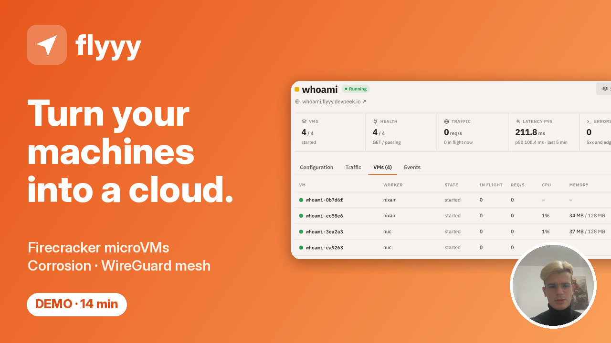
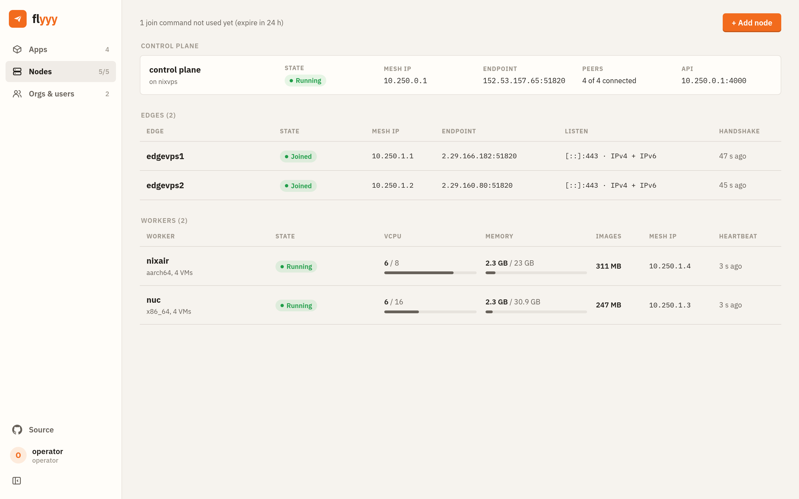
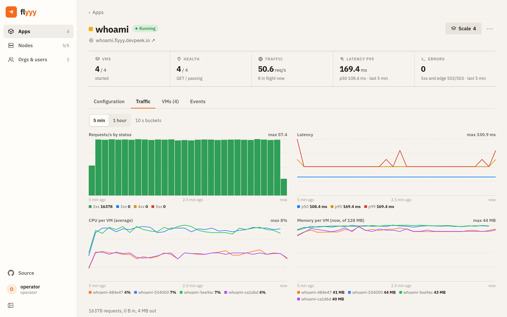
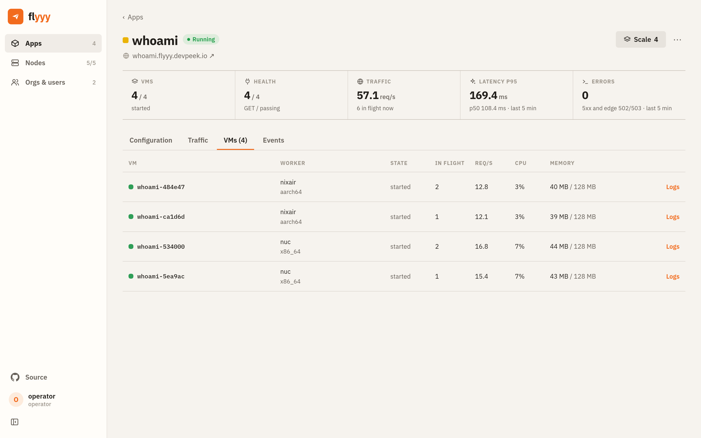
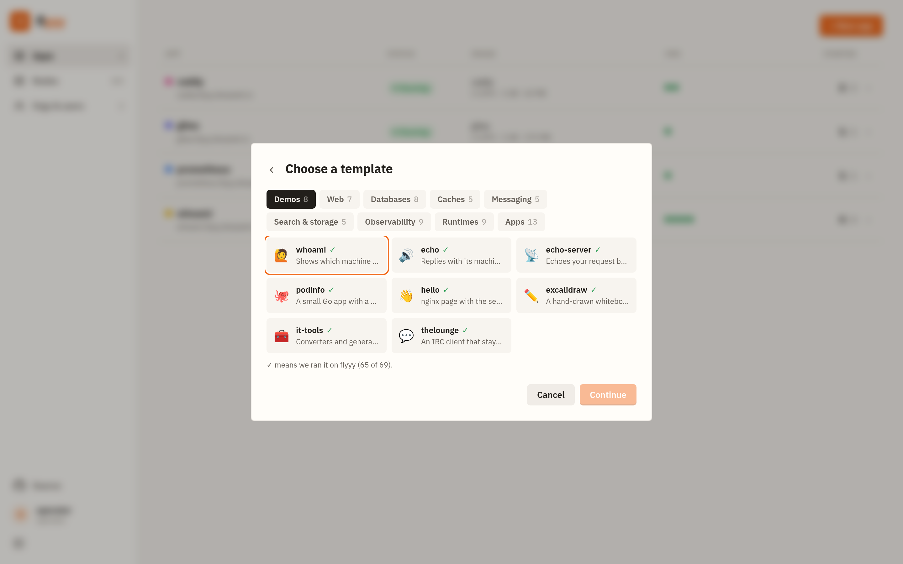
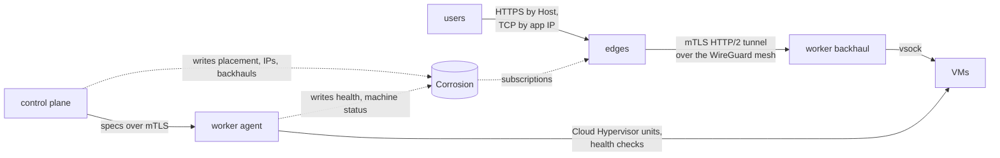

<p align="center"></p>

<h1 align="center">flyyy</h1>

<p align="center"><b>Turn your machines into a cloud:</b> containers as Cloud Hypervisor microVMs, load-balanced across a WireGuard mesh, with routing gossiped over <a href="https://github.com/superfly/corrosion">Corrosion</a>.</p>

**Contents:** [TL;DR](#tldr) · [Features](#features) · [Demo](#demo) · [Screenshots](#screenshots) · [How it works](#how-it-works) · [Operator setup](#operator-setup) · [Tests](#tests) · [Code map](#code-map) · [Links](#links)

## TL;DR

- **Three roles:** the control plane decides, workers run apps as Cloud Hypervisor microVMs, and edges route traffic.
- **Corrosion holds only the routing facts.** The desired state stays in the control plane. Each table has one writer, and only the control plane's rows can bind a route, so a forged worker row routes nothing.
- **Edges outlive the control plane:** they route from their Corrosion subscription alone, so apps keep serving while it's down.
- **VMs have no network card.** Edges reach them only through each worker's mTLS HTTP/2 tunnel, over vsock.
- **Balancing:** power of two choices by requests in flight. Workers health-check their own VMs and write a result only when it changes. After a failed connection, an instance goes to the back of the line for 10 s.
- **Tested on the real modules, with no mocks:** NixOS containers run a real control plane, edges and workers, and a storm suite generates churn. A storm test in stage 3 found [superfly/corrosion#596](https://github.com/superfly/corrosion/issues/596): a node that's behind can miss an update.
- **Not production yet:** Corrosion doesn't authenticate writers, there's one wildcard certificate, one control plane, app IPs are IPv4 only, and metrics live in memory. The [handwritten notes](NOTES.md) tell how it was built and what production needs; [docs/DESIGN.md](docs/DESIGN.md) has the design in detail.

## Features

- 🔥 **Cloud Hypervisor microVMs** from OCI images pinned by digest, on x86_64 and aarch64
- 🌍 **Edges:** HTTPS by Host on shared IPs, TCP services on an app's own IPv4 address
- ⚖️ **Load balancing:** power of two choices by in-flight requests, soft and hard limits, and an instance whose tunnel failed tried last for 10 s
- 🩺 **Health checks** set with the app at the control plane, run by each worker against its own VMs
- 🪶 **Corrosion** carries the routing facts, each table with one writer (two Corrosion fixes carried as patches, one reported upstream)
- 🕸️ **WireGuard mesh** with mTLS; a node joins with a token and your approval, and a worker can sit behind NAT
- 👥 **Orgs and users:** a token decides the org, and other orgs' apps don't exist for you
- 📊 **Per-app traffic, events and VM logs**, no Prometheus needed
- 🧩 **Templates:** about 70 digest-pinned images (whoami, Postgres, Redis, …) to start New app from
- 🛠️ **Rootless `nix run`** on Linux with systemd (sudo only to set it up), or NixOS modules
- 🧪 **NixOS test suites** for each feature, in nspawn containers

## Demo

[](https://youtu.be/V3GrVSR7aMI)

**Video (14 min):** https://youtu.be/V3GrVSR7aMI

**Short on time?** [Jump to 8:55](https://youtu.be/V3GrVSR7aMI?t=535): deploying an app across both workers, traffic spreading over its VMs, and scaling to 4, in about 3 minutes.

From zero: a control plane and dashboard on one VPS, two edges in Hetzner, and two workers behind NAT at home (an x86_64 NUC and an aarch64 MacBook). Then orgs and users, deploying and scaling apps, and isolation between orgs.

| Time | Chapter |
|---|---|
| [0:00](https://youtu.be/V3GrVSR7aMI?t=0) | What flyyy is |
| [0:27](https://youtu.be/V3GrVSR7aMI?t=27) | Architecture: control plane, workers, edges |
| [1:54](https://youtu.be/V3GrVSR7aMI?t=114) | The setup: five machines, a Let's Encrypt wildcard |
| [3:17](https://youtu.be/V3GrVSR7aMI?t=197) | DNS: round robin over two edges instead of anycast |
| [3:34](https://youtu.be/V3GrVSR7aMI?t=214) | Operator setup with Nix |
| [3:57](https://youtu.be/V3GrVSR7aMI?t=237) | Starting the control plane and the dashboard |
| [4:29](https://youtu.be/V3GrVSR7aMI?t=269) | Signing in as the operator |
| [5:06](https://youtu.be/V3GrVSR7aMI?t=306) | Adding two edges |
| [6:15](https://youtu.be/V3GrVSR7aMI?t=375) | Adding two workers behind NAT (x86_64 and aarch64) |
| [7:42](https://youtu.be/V3GrVSR7aMI?t=462) | Worker capacity |
| [7:58](https://youtu.be/V3GrVSR7aMI?t=478) | Orgs and users: acme and bob |
| [8:55](https://youtu.be/V3GrVSR7aMI?t=535) | **Deploying whoami as bob, 2 VMs** |
| [9:43](https://youtu.be/V3GrVSR7aMI?t=583) | The app page: placement, logs, events |
| [10:17](https://youtu.be/V3GrVSR7aMI?t=617) | **Traffic: requests spread across VMs** |
| [11:09](https://youtu.be/V3GrVSR7aMI?t=669) | **Scaling to 4 VMs** |
| [12:08](https://youtu.be/V3GrVSR7aMI?t=728) | Isolation: alice in another org |
| [12:44](https://youtu.be/V3GrVSR7aMI?t=764) | Deploying Excalidraw from a template, scaling to 3 |
| [13:17](https://youtu.be/V3GrVSR7aMI?t=797) | The operator sees both orgs; destroying apps |
| [14:12](https://youtu.be/V3GrVSR7aMI?t=852) | Wrap-up |

## Screenshots

<p align="center">
  
  
  
  
</p>

## How it works



The control plane keeps the desired state and is the only writer of the tables that bind routes. Each worker's agent runs the VMs and writes their health. Each edge follows a Corrosion subscription and routes from it alone, so it keeps serving if the control plane goes down. [docs/DESIGN.md](docs/DESIGN.md) has the design and the failure modes, and the [handwritten notes](NOTES.md) the gaps to production.

How the core parts are covered:

| Part | How | Code | Proven by |
|---|---|---|---|
| **Ingress IPs** | The control plane publishes shared IPs and pools to `ip_pools`. On deploy each app gets a random dedicated IP from a pool, released on destroy and quarantined for 24 h. Edges make every prefix local with AnyIP. | [ingress.rs](proxy/src/ingress.rs), [control/publish.rs](proxy/src/control/publish.rs) | [ips.py](tests/ips.py): "quarantine: pg-a redeployed gets …, not the released …" |
| **Vhosts** | `<app>.<apps domain>`, routed by Host on shared IPs only. HTTP on an app's own IP gets 421. | [edge.rs](proxy/src/edge.rs), [edge_routes.rs](proxy/src/edge_routes.rs) | [ips.py](tests/ips.py): "https on … routes pg-a and pg-b by Host"; [verify.py](tests/verify.py): "edge nope.flyyy.localhost -> 404" |
| **Machines** | Cloud Hypervisor VMs with no NIC, run as systemd user units. They're reachable only over vsock, through their worker's mTLS backhaul. The control plane places them; each agent reconciles what it was given. | [control/placement.rs](proxy/src/control/placement.rs), [agent/vm.rs](proxy/src/agent/vm.rs), [backhaul.rs](proxy/src/backhaul.rs) | [deploy.py](tests/deploy.py): "status --json: 3 machines started, converged"; [lifecycle.py](tests/lifecycle.py) |
| **Services and health checks** | Each machine's http or tcp services, with checks set at deploy. The agent checks its VMs over vsock and writes `service_status` when a result changes. Edges route only to passing instances. | [services.rs](proxy/src/services.rs), [health.rs](proxy/src/health.rs) | [services.py](tests/services.py): "http: only … while … fails its check"; "tcp: …:17000 (the app's own IP) echoes through an instance" |
| **Dynamic environment** | Subscriptions resync after errors. Heartbeats are polled, so they don't churn routes. Stale workers go last, and a failed tunnel ejects an instance for 10 s. Both reconcile loops are level-triggered. | [subscription.rs](proxy/src/subscription.rs), [balance.rs](proxy/src/balance.rs), [control/reconcile.rs](proxy/src/control/reconcile.rs) | [storm.py](tests/storm.py) (1000 transactions, kills, churn, no gaps or leaks); [workers.py](tests/workers.py); [trust.py](tests/trust.py) (forged rows bind nothing) |

Flaky links are simulated by killing and restarting backhauls, edges and Corrosion agents, not by dropping packets.

## Operator setup

Everything is in this flake: `nix run "$FLAKE#<app>"`, where `$FLAKE` is its git URL or a checkout (`.`). The defaults below are the demo's; change them for your hosts:

```sh
FLAKE='git+https://github.com/koxu1996/flyyy?ref=main'
PUBLIC_IP=203.0.113.10             # the control host's public address, where nodes dial WireGuard
DASHBOARD_HOST=flyyy.devpeek.io     # the dashboard's name; apps are https://<app>.$DASHBOARD_HOST/
TLS_CERT=~/flyyy-tls/cert.pem       # a certificate for $DASHBOARD_HOST and *.$DASHBOARD_HOST
TLS_KEY=~/flyyy-tls/key.pem
```

Each app checks the host first (architecture, systemd, WireGuard, `/dev/kvm` on workers). It runs every part as you, and uses sudo only to set them up. Running it again resumes. `--nixos` prints the NixOS module equivalent.

1. **The control host:**
   ```sh
   nix run "$FLAKE#control" -- --endpoint "$PUBLIC_IP"
   nix run "$FLAKE#dashboard" -- --host "$DASHBOARD_HOST" --tls-cert "$TLS_CERT" --tls-key "$TLS_KEY"
   ```
   `#control` makes the mesh and prints the operator token: sign in to the dashboard with it, and the CLI reads it from `/var/lib/flyyy-operator/token`. Open UDP 51820 to it.
2. **Edges and workers:** in the dashboard, **+ Add node** gives one command with a join token, used once within 24 h. Paste it on the new machine, then approve the node in the dashboard (or with `flyyy approve <name>`).
   - **Worker:** any Linux machine with KVM; behind NAT, it works with public edges as is. A forwarded UDP port (`--endpoint`) is needed only when an edge is behind NAT too.
   - **Edge:** needs a public IP and the TLS certificate. It listens on `[::]:443` by default.
3. **DNS and certificates:**
   - **DNS:** point `*.$DASHBOARD_HOST` at the edges, and `$DASHBOARD_HOST` at the dashboard.
   - **Edges:** an already-issued wildcard certificate for `*.$DASHBOARD_HOST` (no ACME); SIGHUP reloads it.
   - **Dashboard:** the certificate must name `$DASHBOARD_HOST` itself too: the wildcard doesn't cover it.
4. **Apps:** + New app in the dashboard, or the CLI (`nix profile install "$FLAKE#flyyy"`).

With NixOS, `nixosModules.control`, `.edge`, `.worker` and `.dashboard` do the same; [nix/examples/](nix/examples) has a control host and a worker.

**One machine for development**, no root, no mesh:
```sh
nix run .#local-control   # the API on :4000; prints FLYYY_API and FLYYY_TOKEN_FILE
nix run .#local-worker    # needs /dev/kvm and a systemd user instance
nix run .#local-edge      # apps on http://<app>.flyyy.localhost:8000/
```

## Tests

```sh
nix build -L .#checks.aarch64-linux.verify   # or x86_64-linux; one suite at a time
nix flake check                              # every check, bench included
```

The suites run the real NixOS modules as systemd-nspawn containers, with no QEMU, inside the Nix build. They need Nix's `uid-range` system feature (`auto-allocate-uids`) and KVM for the workers. Without `uid-range`, run a suite's driver as root: `sudo $(nix build --print-out-paths .#checks.<system>.<name>.driver)/bin/nixos-test-driver`. They're checked on aarch64; on x86_64 only the single-host apps were run by hand.

| Suite | Covers |
|---|---|
| verify | backhauls, spread across edges, 404, 400 and the HTTPS redirect, TLS reload, the edges' tables against their agents, failover |
| deploy | deploy, scale, scale to 0, redeploy (no-op and 409), `kill -9` of the control plane, bad input, an image that can't be pulled |
| lifecycle | unmanaged machines, stop and start, orphans, `kill -9` of an agent, failures with backoff, readiness |
| images | EROFS images built in the background, resumed after a kill |
| storm | 1000 Corrosion transactions with no gaps or reordering across restarts and kills; 20 churn cycles with no leaks |
| workers | heartbeats, late or bad rows, joining at runtime, dead and rejoining workers |
| guest | the VM's PID 1: argv and env, user, signals, zombies |
| services | http and tcp services, failing checks, ejection |
| ips | shared and dedicated IPs, pools, release, quarantine |
| orgs | org isolation, hashed tokens |
| trust | forged rows and a fake backhaul route nothing; VMs keep running with the control plane down |
| balance | balancing by load, hard limits |
| metrics | traffic, CPU and memory per app |
| events | an app's events and its VMs' logs |
| mesh | join, approval, key swap, certificate renewal, the edges' listen addresses |
| join | `#join` on a host without the module |
| hosts | `#control`, `#edge` and `#dashboard` on one host without the modules |
| local | the `local-*` apps as an ordinary user |
| dashboard | the loopback and public dashboards, CSRF, DNS rebinding, the page's pieces |
| page-overflow | the page in headless Chromium: no sideways scroll from 900 to 1400 px, Add node, the Apps checklist |
| clippy, fmt, cargo-test, guest-test, guest-clippy, dashboard-js | the Rust crates' lints, formatting and unit tests; the dashboard's JS helpers |

`bench` (throughput and latency), `boots` and `stack` (`nix run .#stack`, an interactive cluster, needs sudo) are tools, not checks of behaviour.

## Code map

proxy/src:
- `main.rs`, `lib.rs`: the one `proxy <role>` binary and its library.
- `edge.rs`: the edge: HTTP(S) by Host on shared IPs, TCP on each app's own IP, the ingress and stale-worker pollers.
- `edge_routes.rs`: the edge's routes, from a Corrosion subscription to passing services; ejection and stale workers.
- `balance.rs`: power of two choices by requests in flight, with soft and hard limits.
- `pool.rs`: the edge's long-lived HTTP/2 mTLS connections to each worker's backhaul.
- `backhaul.rs`: the worker's side of them: `CONNECT <instance>`, piped to the VM over vsock.
- `health.rs`: the agent's health checks over vsock; writes `service_status` on a change.
- `services.rs`: service definitions (http or tcp, ports, checks) and their validation.
- `ingress.rs`: shared IPs, pools, dedicated IPs with quarantine, and `proxy anyip`.
- `subscription.rs`: follows a Corrosion subscription (snapshot, changes, resync on errors).
- `table.rs`: a route table with one `Arc` per route.
- `corro.rs`: a typed Corrosion API client.
- `states.rs`: the schema's enum columns.
- `mesh.rs`, `wg.rs`: the WireGuard mesh: the control plane's side, and the parts every node shares.
- `pki.rs`: the mesh's certificate authority.
- `tls.rs`: the edge's certificate, reloaded on SIGHUP.
- `http.rs`: listener helpers.
- `vsock.rs`: the VMs' vsock paths (Cloud Hypervisor's hybrid vsock).
- `metrics.rs`: 10 s metric buckets for an hour.
- `dash.rs`, `dashboard.html`: the dashboard and its API forwarder.
- `client.rs`: the control plane API client.
- `templates.json`: New app's templates.
- `api_error.rs`, `random.rs`, `util.rs`: small helpers.
- `control/`: the control plane:
  - `db.rs`: the desired state;
  - `store.rs`, `model.rs`: what's read from Corrosion;
  - `reconcile.rs`, `placement.rs`: the level-triggered loop and where VMs go;
  - `publish.rs`: the only writer of `ip_pools`, `ips`, `placement` and `backhauls`;
  - `agents.rs`: specs pushed to workers;
  - `api.rs`, `routes.rs`, `auth.rs`: the API, its routes and access;
  - `apps.rs`, `orgs.rs`, `workers.rs`, `mesh_routes.rs`, `events.rs`, `load.rs`, `metrics.rs`: its parts.
- `agent/`: the machine agent:
  - `api.rs`: its mTLS API;
  - `desired.rs`: the specs, kept on disk;
  - `plan.rs`, `reconcile.rs`: its loop;
  - `vm.rs`: Cloud Hypervisor as systemd user units;
  - `guest.rs`: the guest's config;
  - `report.rs`, `usage.rs`: the heartbeat, image sizes, CPU and memory.
- `bin/flyyy/`: the `flyyy` CLI: apps, the cluster, the mesh.

Elsewhere:
- `proxy/schema.sql`: the Corrosion tables, each with its one writer.
- `guest/`: `flyyy-init`, the VM's static PID 1 (an EROFS and ext4 overlay root, a vsock relay), and the guest kernel's configs.
- `nix/`:
  - packages, with Corrosion and its patches in `patches/corrosion/`;
  - the `local-*` apps (`apps.nix`);
  - the host apps (`host-apps.nix`, `join.nix`, `host.nix`);
  - the NixOS modules (`modules/`) and their examples (`examples/`).
- `tests/`:
  - the suites;
  - `lib.nix`, the cluster they share;
  - `prelude/`, their Python helpers;
  - `page/`, the browser checks.

## Links

- [NOTES.md](NOTES.md): handwritten notes: how flyyy was built, and the gaps to production.
- [docs/DESIGN.md](docs/DESIGN.md): the design and failure modes, newest last.
- [docs/history/](docs/history): how it got here (the stages, and the prompts that drove them).
- [superfly/corrosion#596](https://github.com/superfly/corrosion/issues/596): the Corrosion sync bug found here, with a [repro](https://github.com/koxu1996/corrosion-dup-seq-divergence). The fix is carried in [nix/patches/corrosion/](nix/patches/corrosion), next to a second fix not sent upstream yet.
